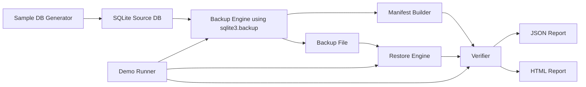

# Backup Recovery Tester

Backup Recovery Tester is a local Python project that validates whether a SQLite backup can be restored and whether restored data exactly matches an expected snapshot.

## Who this is for

Cloud/DevOps learners who want an interview-friendly, practical example for backup automation, restore validation, and integrity checks.

## Features

- Deterministic sample DB generation (`customers`, `orders`)
- Consistent backup via `sqlite3.Connection.backup()`
- Manifest with checksum, schema fingerprint, row counts, and table content hashes
- Isolated restore + integrity checks + foreign key checks + representative query checks
- Failure demo (`python -m recovery_tester demo`)
- JSON and standalone HTML reports
- Pytest + Ruff + Docker + GitHub Actions

## Architecture



## Setup (Ubuntu/WSL)

```bash
cd /home/runner/work/backup-automation/backup-automation
python3.12 -m venv .venv
source .venv/bin/activate
python -m pip install --upgrade pip
pip install -e .[dev]
```

## Setup (Windows PowerShell)

```powershell
cd C:\path\to\backup-automation
py -3.12 -m venv .venv
.\.venv\Scripts\Activate.ps1
python -m pip install --upgrade pip
pip install -e .[dev]
```

## Single-command demo

```bash
python -m recovery_tester demo --artifacts-dir artifacts
```

## CLI commands

```bash
# Create deterministic source data
python -m recovery_tester create-sample ./artifacts/sample/source.sqlite --orders 1000 --seed 42

# Create backup + manifest
python -m recovery_tester backup ./artifacts/sample/source.sqlite --artifacts-dir artifacts

# Verify backup/manifest checksum consistency
python -m recovery_tester verify ./artifacts/<run-id>/backup.sqlite ./artifacts/<run-id>/backup.manifest.json --artifacts-dir artifacts

# Restore backup and run full verification checks
python -m recovery_tester restore-check ./artifacts/<run-id>/backup.sqlite ./artifacts/<run-id>/backup.manifest.json --artifacts-dir artifacts
```

Use `python -m recovery_tester --help` and each subcommand `--help` for details.

## Reports

Each run prints artifact paths. Open reports offline in any browser:

- JSON: machine-readable execution details
- HTML: standalone report with embedded CSS

## Docker

```bash
docker build -t backup-recovery-tester:local .
docker run --rm -v "$(pwd)/docker-output:/app/output" backup-recovery-tester:local
```

`docker-output` keeps reports accessible on host. Ensure your user can write this folder.

## Docker Compose

```bash
docker compose up --build
```

Artifacts appear in `./docker-output`.

## Tests and lint

```bash
ruff check .
pytest
```

- Exit code `0`: success
- Exit code `1`: verification failed / unexpected demo result
- Exit code `2`: invalid usage or operational error

## Troubleshooting and limitations

- This project is local SQLite recovery verification only, not managed cloud backup.
- A checksum + editable manifest detects accidental changes, but does **not** prove authenticity against an attacker who can modify both backup and manifest.
- Timings in reports are from local demo execution and are not production RTO guarantees.
- If SQLite is locked, increase `--timeout`.
